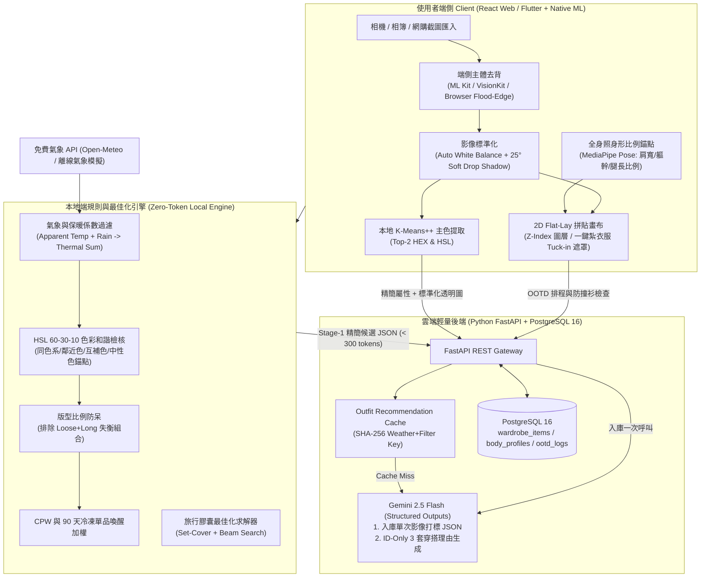
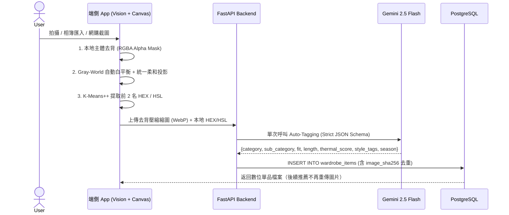

# 1. 系統整體架構圖與資料流說明

## 1.1 架構設計核心原則

本系統針對「**極低雲端算力成本**」與「**高實用性日常穿搭**」進行嚴格分層設計：
1. **視覺零雲端算力（Zero Cloud Vision Cost）**：所有去背（Subject Segmentation）、自動白平衡（Gray-World AWB）、25° 柔和投影（Drop Shadow）、K-Means++ 主色提取、與全身照姿態比例量測（MediaPipe Pose / 瀏覽器端節點校準），100% 於使用者裝置端（React Web Canvas / iOS VisionKit / Android ML Kit）完成。
2. **兩階段混合推薦管線（Two-Stage Hybrid Styling Pipeline）**：
   - **Stage 1（本地／後端規則引擎）**：利用體感溫度與降雨機率計算保暖係數區間、套用 HSL 60-30-10 配色和諧規則與版型防呆（Silhouette Anti-Fool），並對超過 90 天未穿之高 CPW 單品給予喚醒權重加分，將百件衣櫃篩選至 `8~16` 件合格候選單品。
   - **Stage 2（極致省 Token LLM + 離線 Fallback）**：禁止傳送圖片與完整衣櫃，僅將精簡後的 `item_id` + 短屬性 JSON 送入 `Gemini 2.5 Flash`（或前端離線語意評分器），搭配 PostgreSQL Cache Key 快取機制，將單次推薦 Token 消耗壓低至約 **250~550 tokens**（相較圖片多模態推論節省 **97%+**）。

---

## 1.2 系統整體架構圖（Mermaid）

---

## 1.3 核心資料流說明

### 資料流 A：衣物入庫數位化（Wardrobe Digitization Flow）

### 資料流 B：兩階段混合智慧穿搭推薦（Hybrid Styling Flow）
1. **輸入狀態**：取得目前氣溫、濕度/降雨機率、目標場景（通勤／約會／美式復古）或鎖定單品（Anchor Item）。
2. **Stage 1 本地規則漏斗**：
   - `Thermal Filter`：依體感溫度對應目標總保暖分數區間（例如 `14°C 有雨` $\rightarrow$ `thermal_score` 總和 `6~9` 並優先挑選防風/長袖外套）。
   - `HSL 60-30-10 Filter`：排除高飽和衝突配色，保留單色階（$\Delta H \le 15^\circ$）、鄰近色（$\Delta H \le 35^\circ$）、互補對比（$\Delta H \in [155^\circ, 205^\circ]$）與中性色錨點（$S < 18\%$ 或極明／極暗）。
   - `Silhouette Anti-Fool`：非 `oversized` 指定模式時，阻擋 `loose + long` 上衣配 `loose + long` 褲款。
   - `CPW Dormant Boost`：超過 90 天未穿且高單次穿著成本（CPW）的單品獲得喚醒加權。
3. **Cache Key 比對**：計算 `SHA256(sorted(candidate_ids) + temp_bucket + rain + occasion + anchor_id)`；若快取命中直接 0 Token 回傳。
4. **Stage 2 LLM 精簡推理（或瀏覽器端離線語意合成）**：僅送入候選單品的緊湊 JSON 陣列（每件約 18~24 tokens），要求回傳 3 組最佳 `item_ids` 與一句話理由。
5. **2D 畫布渲染**：根據 `user_body_profiles` 的 `torso_length_ratio` 與 `leg_length_ratio` 動態縮放上下著比例，套用 Z-Index 與 Tuck-in 裁切遮罩呈現平拍穿搭。
