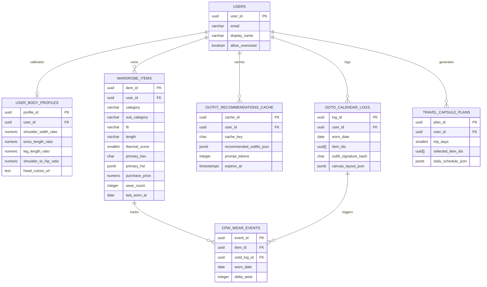

# 2. 關聯式資料庫完整 Schema 設計說明

完整可執行的 PostgreSQL 16 DDL 位於 [`database/schema.sql`](../database/schema.sql)。

## 2.1 實體關聯圖（ER Diagram）

## 2.2 關鍵資料庫設計亮點

1. **影像雜湊去重 (`uq_user_item_hash`)**：透過端側計算 `image_sha256`，防止使用者批次匯入相簿或網購截圖時重複呼叫多模態 LLM 打標，直接省下重複入庫 Token。
2. **結構化屬性強約束 (`CHECK` + `GIN`)**：`category`、`fit`、`length`、`thermal_score (1~5)` 與 LLM Structured Output Enum 完全對應；`style_tags` 與 `season` 採用 PostgreSQL `TEXT[]` 搭配 GIN 索引，支援毫秒級交集篩選。
3. **快取鍵防呆 (`outfit_recommendations_cache`)**：以 `SHA-256(候選單品 ID 列表 + 體感溫度區間 + 降雨旗標 + 風格/鎖定單品)` 作為 `cache_key`，相同天氣與衣櫃狀態重複查詢完全 0 Token。
4. **自動化 CPW 與 90 天冷凍喚醒視圖 (`v_wardrobe_cpw_analytics` + `trg_ootd_increment_wear`)**：
   - 當使用者於 `ootd_calendar_logs` 寫入每日穿搭，PostgreSQL Trigger 自動原子性遞增每件單品的 `wear_count`、更新 `last_worn_at`，並寫入 `cpw_wear_events` 稽核記錄。
   - `v_wardrobe_cpw_analytics` 動態計算 `current_cpw = purchase_price / GREATEST(wear_count, 1)`，以及超過 90 天未穿單品的喚醒加權分數 `awakening_boost_weight`。
5. **14 天防撞衫指紋 (`outfit_signature_hash`)**：對每日上衣／下著／外套核心單品排序雜湊，搭配 `(user_id, outfit_signature_hash, worn_date DESC)` 索引，快速偵測近期重複穿搭。
